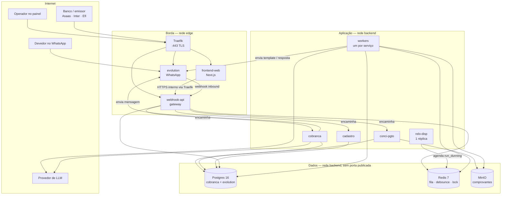
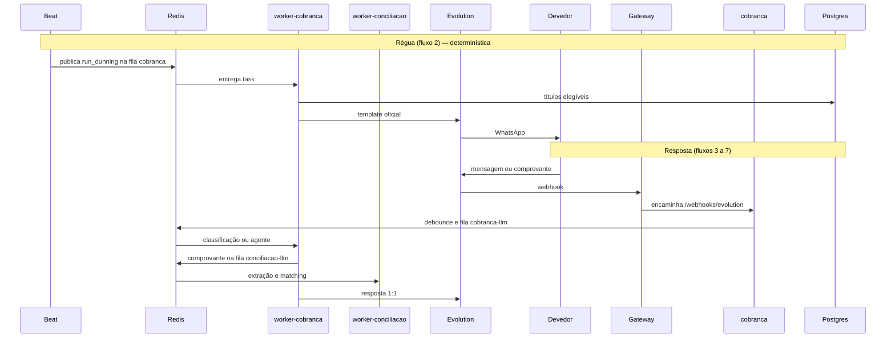
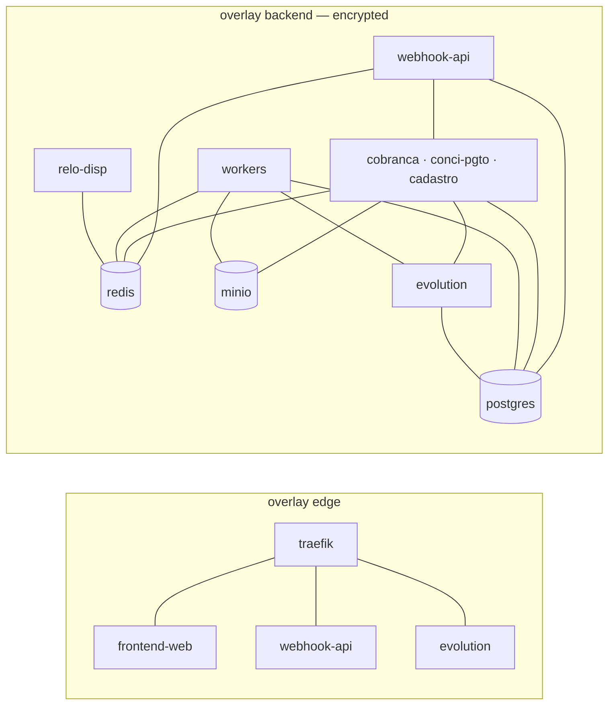
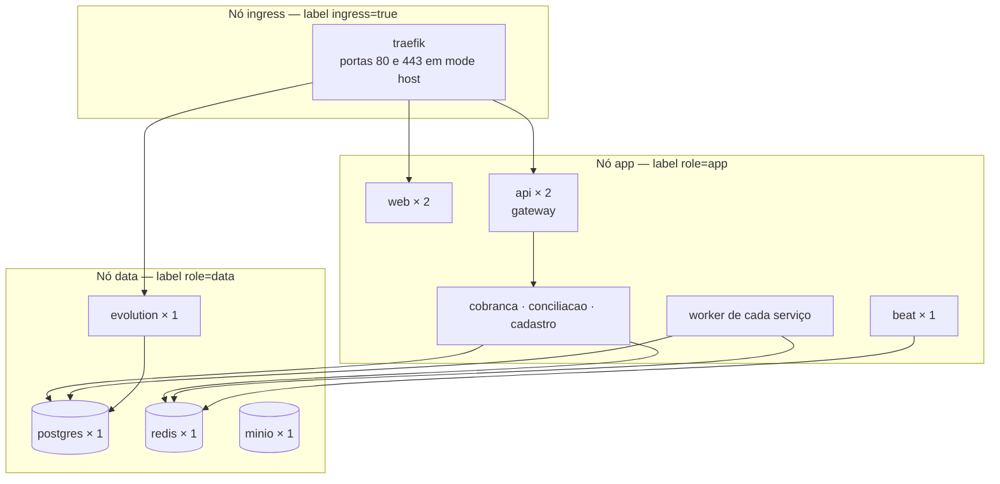
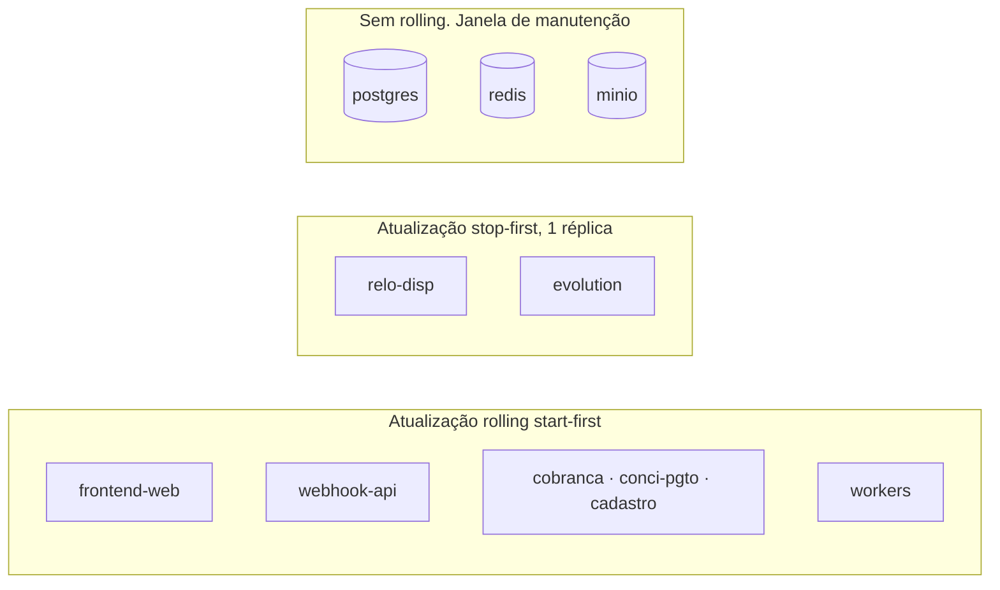

# Arquitetura e deploy — Docker Swarm

> Desenho de runtime do Settlr.
> Complementa [`Settlr — Arquitetura.md`](./Settlr%20%E2%80%94%20Arquitetura.md)
> e [`FLUXOS.md`](./FLUXOS.md).
>
> A stack sobe no Docker Swarm e é operada pelo Portainer. O arquivo que o deploy
> usa é [`docker/stack.yml`](./docker/stack.yml). A seção [9](#9-stackyml-de-referência)
> descreve esse arquivo; não há uma segunda cópia do YAML aqui.

## Índice

1. [Decisões de deploy](#1-decisões-de-deploy)
2. [Desenho da arquitetura](#2-desenho-da-arquitetura)
3. [Fronteiras de rede](#3-fronteiras-de-rede)
4. [Desenho da stack no Swarm](#4-desenho-da-stack-no-swarm)
5. [Catálogo de serviços](#5-catálogo-de-serviços)
6. [Persistência, secrets e config](#6-persistência-secrets-e-config)
7. [Ingress, TLS e rotas](#7-ingress-tls-e-rotas)
8. [Regras de réplica e atualização](#8-regras-de-réplica-e-atualização)
9. [stack.yml de referência](#9-stackyml-de-referência)
10. [Operação](#10-operação)
11. [Ambientes](#11-ambientes)
12. [Fora do Swarm](#12-fora-do-swarm)

---

## 1. Decisões de deploy

| Decisão | Escolha |
| --- | --- |
| Orquestrador | Docker Swarm |
| Operação da stack | Portainer (stack já existente no cluster) |
| Proxy | Traefik v3, provider Swarm, TLS via Let's Encrypt |
| Processos da aplicação | `frontend-web`, `webhook-api` (gateway), `cobranca`, `conci-pgto`, `cadastro`, um worker por serviço, `relo-disp` |
| Broker e locks | Redis 7 (AOF) |
| Banco | Postgres 16, um serviço, dois databases (`cobranca` e `evolution`) |
| Arquivos (comprovantes) | MinIO (API S3), um volume no nó de dados |
| WhatsApp | Evolution API, uma réplica (sessão é estado local) |
| Migrações | Job one-off de Alembic **antes** de atualizar os serviços da API |
| Telemetria | OpenTelemetry para a stack `cobranca-obs` (`observability/stack.yml`): Prometheus, Thanos, Loki, Tempo, Grafana |
| Erros (opcional) | Sentry (SaaS), só com `SENTRY_DSN` |
| Traces de LLM (opcional) | Langfuse, só com `LANGFUSE_PUBLIC_KEY` e `LANGFUSE_SECRET_KEY` |

O piloto cabe num único nó. Produção separa três papéis por label de nó:
`ingress`, `app` e `data`. Os serviços com estado ficam presos ao nó `data`.

---

## 2. Desenho da arquitetura

Três planos: borda HTTP, aplicação e dados. O painel e os webhooks entram pela
borda. Workers e o Beat não têm porta publicada.



### Quem faz o quê

| Serviço | Processo | Fala com | Não faz |
| --- | --- | --- | --- |
| `frontend-web` | Next.js standalone | API via HTTPS | Não acessa Postgres, Redis nem MinIO |
| `webhook-api` | Gateway FastAPI | Postgres, Redis e os três serviços | Não aplica régua, matching nem regra de cadastro |
| `cobranca` | Uvicorn | Postgres, Redis, Evolution, LLM | Não dá baixa nem importa título |
| `conci-pgto` | Uvicorn | Postgres, Redis, MinIO, Evolution, LLM | Não conversa nem agenda a régua |
| `cadastro` | Uvicorn | Postgres, Redis | Não cobra e não concilia |
| `worker-cobranca` | Celery (`cobranca`, `cobranca-llm`) | Postgres, Redis, Evolution, LLM | Não consome fila dos outros |
| `worker-conciliacao` | Celery (`conciliacao`, `conciliacao-llm`) | Postgres, Redis, MinIO, Evolution, LLM | Não consome fila dos outros |
| `worker-cadastro` | Celery (`cadastro`) | Postgres, Redis | Não consome fila dos outros |
| `relo-disp` | Celery Beat | Redis | Não executa a task; só publica `run_dunning` e `check_promises` |
| `evolution` | Evolution API | WhatsApp, Postgres, webhook da API | Não contém regra de cobrança |
| `postgres` | Postgres 16 | — | Sem publish de porta |
| `redis` | Redis 7 | — | Sem publish de porta |
| `minio` | MinIO | — | Console sem rota pública |

### Caminho de cada entrada



O painel e os webhooks entram no gateway (`webhook-api`). Ele encaminha `/webhooks/banco`
e `/payments` para `conci-pgto`, `/webhooks/emissor` e `/invoices` para `cadastro`,
`/webhooks/evolution` e `/conversations` para `cobranca`. Quem grava o pagamento
e enfileira o matching é a conciliação, na fila dela.

O painel (`frontend-web`) só chama a API. Confirmar ou rejeitar uma exceção passa por
rota autenticada, que grava `audit_log`.

Com `OTEL_EXPORTER_OTLP_ENDPOINT` preenchido, gateway, serviços e workers exportam
traces, logs e métricas para o coletor da stack `cobranca-obs`, na rede `backend`.
O padrão é `http://otel-collector:4317`. Vazio desliga o OTLP. O Grafana publica
`:3001` no nó de dados e não entra no Traefik.

---

## 3. Fronteiras de rede

Duas redes overlay. Nada de dado sensível fica na rede da borda além do que o
Traefik precisa rotear.



| Rede | Quem entra | Para quê |
| --- | --- | --- |
| `edge` | traefik, frontend-web, webhook-api (gateway), evolution | HTTP público com TLS |
| `backend` | webhook-api, cobranca, conci-pgto, cadastro, workers, relo-disp, evolution, postgres, redis, minio | Tráfego interno. Overlay com `encrypted: "true"` |

`postgres`, `redis` e `minio` **não** entram na rede `edge` e **não** publicam
porta no host. O firewall do nó libera só `22`, `80` e `443`.

`cobranca`, `conci-pgto`, os workers desses dois e a `evolution` precisam de
saída para a internet (LLM, WhatsApp, webhooks de resposta). A rede `backend`
fica sem a flag `internal: true` para essa saída existir. O isolamento é a
ausência de porta publicada. Os serviços de domínio não entram na rede `edge`.

---

## 4. Desenho da stack no Swarm

### Topologia de nós

Piloto (um VPS): todos os serviços no mesmo nó. Nesse caso, remova os blocos
`placement` de `docker/stack.yml` antes do deploy. No cluster, os labels abaixo
são obrigatórios.

Produção (cluster pequeno):



Labels aplicadas antes do primeiro deploy:

```bash
docker node update --label-add ingress=true  <nó-ingress>
docker node update --label-add role=app      <nó-app>
docker node update --label-add role=data     <nó-data>
```

Volumes do Swarm são locais ao nó. Por isso `postgres`, `redis`, `minio` e
`evolution` têm `replicas: 1` e constraint `node.labels.role == data`. Subir
uma segunda réplica desses serviços criaria um disco vazio, não um cluster.

### Mapa da stack

```text
stack cobranca
├── traefik              borda, manager ou nó ingress
├── web                  painel, stateless
├── api                  gateway, única API na rede edge
├── cobranca             conversa, aprovações, webhook do WhatsApp
├── conciliacao          pagamentos, exceções, webhook do banco
├── cadastro             títulos, configuração, métricas, webhook do emissor
├── worker-cobranca      filas cobranca e cobranca-llm
├── worker-conciliacao   filas conciliacao e conciliacao-llm
├── worker-cadastro      fila cadastro
├── beat                 agenda, singleton
├── evolution            sessão WhatsApp, stateful
├── postgres             stateful
├── redis                stateful (AOF)
└── minio                stateful

volumes: postgres_data, redis_data, minio_data, evolution_instances, traefik_letsencrypt
secrets: postgres_password, postgres_app_password, redis_password, evolution_api_key,
         jwt_secret, llm_api_key, minio_root_password, webhook_hmac
rede:    edge (externa, compartilhada com o Traefik), backend (da stack)
```

O Portainer já corre à parte, no mesmo cluster. Esta stack não inclui o
Portainer.

---

## 5. Catálogo de serviços

| Serviço | Imagem | Réplicas | Porta interna | Constraint | Healthcheck |
| --- | --- | --- | --- | --- | --- |
| `traefik` | `traefik:v3.1` | 1 | 80, 443 | `ingress=true` | `traefik healthcheck` |
| `frontend-web` | build `./web` | 2 | 3000 | `role=app` | `GET /` |
| `webhook-api` | `cobranca-api` (gateway) | 2 | 8000 | `role=app` | `GET /health` |
| `cobranca` | `cobranca-api` | 2 | 8000 | `role=app` | `GET /health` |
| `conci-pgto` | `cobranca-api` | 2 | 8000 | `role=app` | `GET /health` |
| `cadastro` | `cobranca-api` | 2 | 8000 | `role=app` | `GET /health` |
| `worker-cobranca` | `cobranca-api` | 2 | — | `role=app` | `celery inspect ping` |
| `worker-conciliacao` | `cobranca-api` | 2 | — | `role=app` | `celery inspect ping` |
| `worker-cadastro` | `cobranca-api` | 1 | — | `role=app` | `celery inspect ping` |
| `relo-disp` | `cobranca-api` | 1 | — | `role=app` | processo vivo |
| `evolution` | `atendai/evolution-api:v2.2.3` | 1 | 8080 | `role=data` | `GET /` |
| `postgres` | `postgres:16` | 1 | 5432 | `role=data` | `pg_isready` |
| `redis` | `redis:7` | 1 | 6379 | `role=data` | `redis-cli ping` |
| `minio` | `minio/minio:RELEASE.2024-12-18` | 1 | 9000 | `role=data` | `GET /minio/health/live` |

### Comandos

| Serviço | Comando |
| --- | --- |
| `webhook-api` | `uvicorn app.main:app --host 0.0.0.0 --port 8000` |
| `cobranca` | `uvicorn app.services.cobranca:app --host 0.0.0.0 --port 8000` |
| `conci-pgto` | `uvicorn app.services.conciliacao:app --host 0.0.0.0 --port 8000` |
| `cadastro` | `uvicorn app.services.cadastro:app --host 0.0.0.0 --port 8000` |
| `worker-cobranca` | `celery … worker -Q cobranca,cobranca-llm --concurrency=4` |
| `worker-conciliacao` | `celery … worker -Q conciliacao,conciliacao-llm --concurrency=2` |
| `worker-cadastro` | `celery … worker -Q cadastro --concurrency=2` |
| `relo-disp` | `celery -A app.workers.celery_app beat --loglevel=info` |
| `frontend-web` | processo do build `standalone` do Next.js, porta 3000 |
| `minio` | `server /data --console-address :9001` |

`/health` de cada processo HTTP checa Postgres e Redis e responde `200` só
quando os dois respondem. O corpo traz `service` (`gateway`, `cobranca`,
`conciliacao` ou `cadastro`). O Traefik só publica o gateway e tira da rotação
a réplica que falhar.

### Recursos de partida (piloto)

Valores para um nó de 4 vCPU / 8 GB. Ajustar depois de medir o piloto.

| Serviço | Limite de memória | Reserva |
| --- | --- | --- |
| `postgres` | 1 GB | 512 MB |
| `redis` | 256 MB | 128 MB |
| `minio` | 512 MB | 256 MB |
| `evolution` | 512 MB | 256 MB |
| `webhook-api` (cada réplica) | 256 MB | 128 MB |
| `cobranca`, `conci-pgto`, `cadastro` | 384 MB | 192 MB |
| `worker-cobranca`, `worker-conciliacao` | 768 MB | 384 MB |
| `worker-cadastro` | 384 MB | 192 MB |
| `frontend-web` (cada réplica) | 256 MB | 128 MB |
| `relo-disp` | 128 MB | 64 MB |
| `traefik` | 128 MB | 64 MB |

O worker de conciliação pede mais memória porque a task de comprovante carrega
imagem e chama o LLM. Se a fila crescer, sobe a réplica do worker daquele
serviço, para o Swarm redistribuir entre nós `app`.

---

## 6. Persistência, secrets e config

### Volumes

| Volume | Serviço | Conteúdo | Backup |
| --- | --- | --- | --- |
| `postgres_data` | postgres | databases `cobranca` e `evolution` | `pg_dump` diário, cópia fora do nó |
| `redis_data` | redis | AOF da fila, debounce e locks | Reconstruível; dump só para encurtar replay |
| `minio_data` | minio | comprovantes | réplica do bucket para storage externo |
| `evolution_instances` | evolution | sessão do WhatsApp | copiar com o nó; perda pede novo QR |
| `traefik_letsencrypt` | traefik | `acme.json` | copiar; permissão `600` |

Init do Postgres (roda só com o volume vazio) cria a role `cobranca_app`, a role
`evolution` e o database `evolution`. O roteiro completo, com Alembic, RLS e a
conferência, está em [`docs/BANCO.md`](./docs/BANCO.md).

A aplicação usa `cobranca`. A Evolution usa `evolution`. Databases separados
evitam a migration da Evolution misturar com o Alembic.

RLS por `tenant_id` fica nas migrations Alembic do database `cobranca`. A role
da API (`cobranca_app`) não é superuser nem dona das tabelas. A role `cobranca`
só entra no job de migração.

### Secrets

Criados no Portainer (ou `docker secret create`) antes do deploy. O `stack.yml`
os referencia como `external: true`. Nenhum segredo entra na imagem nem no Git.

| Secret | Quem lê |
| --- | --- |
| `postgres_password` | postgres (role dona do schema) e o job de migração; evolution |
| `postgres_app_password` | postgres, gateway, cobrança, conciliação, cadastro e os três workers |
| `redis_password` | redis, gateway, os três serviços HTTP, os três workers, beat |
| `evolution_api_key` | evolution, cobrança, conciliação, worker-cobranca, worker-conciliacao |
| `jwt_secret` | gateway, cobrança, conciliação e cadastro (validam o JWT do painel) |
| `llm_api_key` | cobrança, conciliação, worker-cobranca, worker-conciliacao |
| `minio_root_password` | minio, conciliação, worker-conciliacao |
| `webhook_hmac` | evolution, cobrança (WhatsApp) e conciliação (banco) |

Variáveis não secretas (hosts internos, nomes de bucket, horário padrão) vão
em `environment` da stack.

URLs internas, resolvidas pelo DNS do Swarm:

| Variável | Valor |
| --- | --- |
| `DATABASE_URL` | `postgresql://cobranca:<secret>@postgres:5432/cobranca` |
| `REDIS_URL` | `redis://:<secret>@redis:6379/0` |
| `CELERY_BROKER_URL` | mesmo Redis, database `1` |
| `S3_ENDPOINT` | `http://minio:9000` |
| `EVOLUTION_BASE_URL` | `http://evolution:8080` |
| `COBRANCA_URL` | `http://cobranca:8000` (só o gateway encaminha) |
| `CONCILIACAO_URL` | `http://conci-pgto:8000` |
| `CADASTRO_URL` | `http://cadastro:8000` |
| `WEB_API_BASE_URL` | `https://api.<domínio>` (o browser do operador chama o gateway pela borda) |

O `frontend-web` recebe `WEB_API_BASE_URL` em **build** (Next.js standalone). Trocar de
domínio exige rebuild da imagem `cobranca-web`.

### O que cada database do Redis guarda

| DB | Uso |
| --- | --- |
| `0` | debounce de mensagens inbound e locks de baixa (`e2e_id`) |
| `1` | broker Celery |
| `2` | result backend Celery, com TTL curto |

---

## 7. Ingress, TLS e rotas

Um certificado por host, HTTP-01 no Traefik.

| Host | Serviço | Quem acessa |
| --- | --- | --- |
| `app.<domínio>` | `frontend-web:3000` | operador do tenant |
| `api.<domínio>` | `webhook-api:8000` (gateway) | painel, banco, emissor, Evolution |
| `wa.<domínio>` | `evolution:8080` | webhook de volta do WhatsApp e pareamento do número |

O manager da Evolution (`wa.<domínio>`) fica com basic auth no Traefik ou
middleware de IP allowlist. A API key da Evolution continua obrigatória em
toda rota.

Rotas da API que a borda precisa deixar passar sem sessão de usuário, com
verificação de assinatura no código:

| Rota pública | Origem | Serviço que executa |
| --- | --- | --- |
| `POST /webhooks/evolution` | Evolution | `cobranca` |
| `POST /webhooks/emissor` | Asaas, Inter, Efí | `cadastro` |
| `POST /webhooks/banco` | extrato / PIX | `conci-pgto` |
| `GET /health` | Traefik | `webhook-api` (gateway) |

A assinatura é conferida no serviço dono da rota, depois do gateway encaminhar
o corpo sem alterá-lo. Cobrança, conciliação e cadastro não têm router no Traefik.

O console do MinIO (`:9001`) não ganha router no Traefik.

---

## 8. Regras de réplica e atualização



| Serviço | `order` | `parallelism` | Motivo |
| --- | --- | --- | --- |
| `frontend-web`, `webhook-api`, `cobranca`, `conci-pgto`, `cadastro` | `start-first` | 1 | réplica nova saudável entra antes de tirar a antiga |
| `worker-cobranca`, `worker-conciliacao`, `worker-cadastro` | `start-first` | 1 | a fila daquele serviço não para durante o deploy |
| `relo-disp` | `stop-first` | 1 | duas agendas disparariam a régua em dobro |
| `evolution` | `stop-first` | 1 | uma sessão WhatsApp por volume |
| `postgres`, `redis`, `minio` | `stop-first` | 1 | um volume, uma réplica |

`relo-disp` usa `deploy.replicas: 1` e `update_config.order: stop-first`. Colocar
o Beat em `mode: global` ou subir a réplica faz a régua disparar duas vezes.

Migração de schema:

1. Build das imagens `cobranca-api` e `cobranca-web` com a tag do release (`cobranca-api:<git-sha>`).
2. Container one-off, mesma imagem `cobranca-api`, comando `python -m app.cli migrate`, na rede `backend`.
3. Só com o Alembic em exit 0, atualizar a stack para a nova tag.
4. Rollback de aplicação é voltar a tag. Rollback de schema é migration reversa escrita no Alembic, aplicada do mesmo jeito one-off.

Nenhum serviço roda `alembic upgrade` no entrypoint. Duas réplicas subindo juntas
disputariam o lock de migration.

---

## 9. stack.yml de referência

O arquivo que o Swarm sobe é [`docker/stack.yml`](./docker/stack.yml). O Portainer
faz o deploy desse arquivo. Esta seção não repete o YAML.

A imagem `cobranca-api` é uma só. O comando e a rede mudam por serviço:

| Serviço | Comando | Rede |
| --- | --- | --- |
| `webhook-api` | `uvicorn app.main:app --port 8000` | `edge` e `backend` |
| `cobranca` | `uvicorn app.services.cobranca:app --port 8000` | `backend` |
| `conci-pgto` | `uvicorn app.services.conciliacao:app --port 8000` | `backend` |
| `cadastro` | `uvicorn app.services.cadastro:app --port 8000` | `backend` |
| `worker-cobranca` | `celery … worker -Q cobranca,cobranca-llm` | `backend` |
| `worker-conciliacao` | `celery … worker -Q conciliacao,conciliacao-llm` | `backend` |
| `worker-cadastro` | `celery … worker -Q cadastro` | `backend` |
| `relo-disp` | `celery … beat` | `backend` |

Só o gateway (`webhook-api`), o `frontend-web` e a Evolution entram na rede `edge` e recebem
router no Traefik. `COBRANCA_URL`, `CONCILIACAO_URL` e `CADASTRO_URL` apontam
para `http://<serviço>:8000` na rede `backend`.

No piloto de um nó, remova os blocos `placement`. A rede `edge` é externa; se
este Traefik for o primeiro, crie-a antes:

```bash
docker network create --driver overlay --attachable edge
```

Notas ao lado de `docker/stack.yml`:

- `DATABASE_URL`, `REDIS_URL` e `DATABASE_CONNECTION_URI` da Evolution são
  montadas no entrypoint a partir dos secrets, para a senha não aparecer em
  `docker service inspect`.
- A role `evolution` e o database `evolution` nascem num script em
  `docker-entrypoint-initdb.d`, executado só quando `postgres_data` está vazio.
- A role `cobranca_app` nasce no mesmo script. Os serviços da aplicação usam
  essa role (`postgres_app_password`), não a dona do schema.
- `IMAGE_TAG` e `REGISTRY` são as variáveis que o Portainer pede no deploy.
- Task sem rota em `app/services/queues.py` cai na fila `sem-dono`. Nenhum
  worker a consome.

---

## 10. Operação

### Primeira subida

1. Labels nos nós (`ingress`, `role=app`, `role=data`).
2. Rede overlay `edge`.
3. Secrets no Portainer.
4. Build e push de `cobranca-api` e `cobranca-web` para o registry.
5. Deploy da stack com `IMAGE_TAG` apontando para esse build.
6. Esperar `postgres` saudável. Rodar o script que cria database e role
   `evolution` se o init não tiver rodado.
7. One-off: `alembic upgrade head`.
8. Criar o bucket `comprovantes` no MinIO.
9. Parear o número na Evolution (QR) e gravar o webhook global para
   `https://api.<domínio>/webhooks/evolution`.
10. Cadastrar o tenant piloto: política, régua, horário, número e emissor.

### Atualização de release

```text
build imagens com o git sha
    → alembic upgrade head (one-off)
        → Portainer atualiza IMAGE_TAG
            → Swarm faz rolling em frontend-web, webhook-api, cobranca, conci-pgto, cadastro e nos três workers
            → Swarm faz stop-first em relo-disp
```

`failure_action: rollback` devolve a tag anterior se o healthcheck da réplica
nova falhar. A pipeline `.github/workflows/release.yml` faz o mesmo por fora:
sobe a tag do SHA e, se `frontend-web`, `webhook-api`, `cobranca`, `conci-pgto`, `cadastro`,
os três workers e `relo-disp` não ficarem em execução nessa tag, republica a anterior
(`docker/release.sh`). Um rollback manual é o
`workflow_dispatch` com `rollback_to`. Schema incompatível com a tag antiga
exige a migration reversa antes de voltar a imagem. Sem os secrets de deploy,
a pipeline só publica as imagens no GHCR.

### Escalar

| Sintoma | Ação |
| --- | --- |
| Fila de um serviço crescendo | `docker service scale cobranca_worker-cobranca=N` (ou `worker-conciliacao`, `worker-cadastro`) |
| API lenta em webhook | subir a réplica do serviço dono (`cobranca`, `conci-pgto` ou `cadastro`); o gateway só encaminha |
| Beat atrasado | olhar o nó, nunca duplicar o serviço |
| Disco do nó `data` | volume do Postgres e do MinIO; comprovante antigo sai por política de retenção |

### Backup

| O quê | Como | Frequência |
| --- | --- | --- |
| `cobranca` e `evolution` | `pg_dump -Fc` no nó `data`, cópia para fora do cluster | diário, retenção 30 dias |
| bucket `comprovantes` | `mc mirror` para storage externo | diário |
| `evolution_instances` | cópia do volume junto com o dump | diário |
| secrets | cofre fora do cluster (Portainer não é backup) | a cada rotação |

Restore de Postgres é em volume novo, com a stack parada nos serviços que escrevem
no banco (`webhook-api`, `cobranca`, `conci-pgto`, `cadastro`, os três workers, `relo-disp`
e `evolution`). Subir de novo só depois do `pg_restore` terminar.

### Logs e telemetria

Driver `json-file` com `max-size: 10m` e `max-file: 5` em todos os serviços.
Fora de `ENV=dev`, o log da aplicação sai em JSON e leva `trace_id` quando há span ativo.

A stack `cobranca-obs` (`observability/stack.yml`) entra na mesma rede `backend`:

```bash
BACKEND_NETWORK=cobranca_backend docker stack deploy \
  -c observability/stack.yml cobranca-obs
```

| Peça | Papel |
| --- | --- |
| `otel-collector` | Recebe OTLP (`:4317`). Traces vão ao Tempo, logs ao Loki, métricas de recurso ao Prometheus por remote write. No Swarm também lê hostmetrics e `docker_stats` |
| `promtail` | Envia o stdout dos containers ao Loki |
| `prometheus` | Raspa `/internal/metrics` dos quatro processos HTTP, mais exporters de Postgres, Redis e Celery. Retenção de 6 horas |
| `thanos-sidecar`, `thanos-store`, `thanos-query`, `thanos-compactor` | Histórico longo. O Grafana usa o `thanos-query` como datasource padrão |
| `tempo` | Traces. Grava span metrics de volta no Prometheus |
| `loki` | Logs |
| `grafana` | Porta 3001 no nó de dados. Pasta **Cobrança**, painel `Cobrança — aplicação` |
| `postgres-exporter`, `redis-exporter`, `celery-exporter` | Métricas de infra que o Prometheus raspa |

Sentry, com `SENTRY_DSN`, recebe exceção. Langfuse, com as duas chaves, recebe só os traces dos três pontos de LLM: intenção, comprovante e negociação. Os dois ficam desligados sem variável e não fazem parte da stack.

---

## 11. Ambientes

Duas stacks no mesmo cluster, nomes diferentes, redes `backend` diferentes.
A rede `edge` pode ser compartilhada; o host do Traefik separa o tráfego.

| | `cobranca` (produção) | `cobranca-hml` (homologação) |
| --- | --- | --- |
| Hosts | `app.`, `api.`, `wa.` | `app-hml.`, `api-hml.`, `wa-hml.` |
| Postgres | volume próprio | volume próprio, dump anonimizado |
| Evolution | número oficial do tenant | número de teste |
| Réplicas | as da tabela da seção 5 | 1 para cada serviço |
| LLM | projeto de produção | projeto com teto de gasto |

Homologação usa a mesma `stack.yml` e outra `IMAGE_TAG`. Secrets são outros
nomes (`postgres_password_hml`, etc.).

---

## 12. Fora do Swarm

| Peça | Onde fica | Por quê |
| --- | --- | --- |
| Portainer | já instalado no cluster | opera esta stack; não faz parte dela |
| Provedor de LLM | API externa | chamada só nos três pontos de IA |
| Sentry | SaaS, opcional | erros, só com `SENTRY_DSN` |
| Langfuse | endpoint externo, opcional | traces de LLM, só com as duas chaves |
| Minikube | `k8s/minikube.yaml` e `k8s/observability` | cluster local; não substitui o Swarm de produção |
| Registry das imagens | GHCR ou registry privado | o Swarm puxa por tag, não faz build no nó |
| Backup externo | storage fora do nó `data` | o volume local não sobrevive à perda do disco |

O OTLP liga por `OTEL_EXPORTER_OTLP_ENDPOINT`. Com a variável vazia, cobrança e conciliação seguem sem telemetria. No Minikube o mesmo coletor vive no namespace `observability` e os painéis de Kubernetes (métricas USE, logs e traces RED) só existem nesse manifesto. O detalhe dos sinais está na seção 10 de [`docs/TECNICA.md`](./docs/TECNICA.md). O mapa da stack está em [`docs/OBSERVABILIDADE.md`](./docs/OBSERVABILIDADE.md).
