# Fluxos do Settlr

> Documento de detalhamento operacional dos fluxos descritos em
> [`Settlr — Arquitetura.md`](./Settlr%20%E2%80%94%20Arquitetura.md).
>
> Objetivo: descrever **passo a passo** cada fluxo do produto — gatilhos, decisões,
> estados, regras duras e pontos de escalonamento humano — para servir de base de
> implementação (gateway + cobrança, conciliação e cadastro, Celery e Postgres).

## Índice

1. [Convenções e princípios](#1-convenções-e-princípios)
2. [Mapa geral dos fluxos](#2-mapa-geral-dos-fluxos)
3. [Fluxo 0 — Onboarding do tenant](#3-fluxo-0--onboarding-do-tenant)
4. [Fluxo 1 — Ingestão de títulos](#4-fluxo-1--ingestão-de-títulos)
5. [Fluxo 2 — Régua de cobrança (dunning)](#5-fluxo-2--régua-de-cobrança-dunning)
6. [Fluxo 3 — Inbound do WhatsApp e classificação de intenção](#6-fluxo-3--inbound-do-whatsapp-e-classificação-de-intenção)
7. [Fluxo 4 — Agente de negociação (LangGraph)](#7-fluxo-4--agente-de-negociação-langgraph)
8. [Fluxo 5 — Promessas de pagamento](#8-fluxo-5--promessas-de-pagamento)
9. [Fluxo 6 — Processamento de comprovante](#9-fluxo-6--processamento-de-comprovante)
10. [Fluxo 7 — Conciliação / matching em camadas](#10-fluxo-7--conciliação--matching-em-camadas)
11. [Fluxo 8 — Fila de exceções e revisão humana](#11-fluxo-8--fila-de-exceções-e-revisão-humana)
12. [Fluxo 9 — Opt-out e escalonamento](#12-fluxo-9--opt-out-e-escalonamento)
13. [Máquina de estados do título](#13-máquina-de-estados-do-título)
14. [Máquina de estados do pagamento](#14-máquina-de-estados-do-pagamento)
15. [Matriz de guardrails por fluxo](#15-matriz-de-guardrails-por-fluxo)

---

## 1. Convenções e princípios

**Regra de ouro.** O LLM só atua em três pontos: (a) leitura do comprovante,
(b) classificação de intenção e (c) conversa de negociação. **Régua, matching e
baixa são código determinístico.**

**Multi-tenant.** Tudo é escopado por `tenant_id` com Row Level Security no
Postgres. Nenhum fluxo cruza dados entre tenants.

**Auditoria.** Toda ação que altera estado grava em `audit_log` (quem, o quê,
quando, antes/depois).

**Determinismo primeiro.** O LLM nunca decide sobre dinheiro: ele interpreta
texto/imagem e **escolhe entre opções que o código já validou** pela política.

Legenda dos diagramas:

- 🟩 código determinístico
- 🟦 LLM (IA)
- 🟥 ação humana / escalonamento

---

## 2. Mapa geral dos fluxos

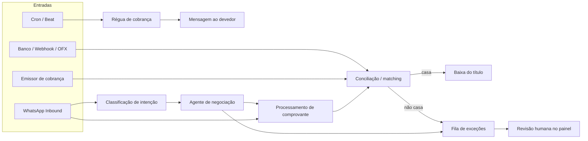

**Quem executa.** O painel e os webhooks entram no gateway. Ele encaminha ao serviço dono. A task roda no worker daquele serviço. O Postgres é um só: baixa e status do título não atravessam HTTP.

| # | Fluxo | Gatilho | Serviço | LLM? |
| --- | --- | --- | --- | --- |
| 0 | Onboarding | Humano (agência) | cadastro | não |
| 1 | Ingestão de títulos | Upload / webhook emissor | cadastro + worker-cadastro | não |
| 2 | Régua de cobrança | Cron (Beat) | beat + worker-cobranca | não |
| 3 | Inbound WhatsApp | Webhook Evolution | gateway → cobranca + worker-cobranca | 🟦 intenção |
| 4 | Agente de negociação | Resposta do devedor | worker-cobranca | 🟦 conversa |
| 5 | Promessas | Intenção "vou pagar" | worker-cobranca | não |
| 6 | Comprovante | Imagem/PDF recebido | worker-conciliacao | 🟦 extração |
| 7 | Conciliação | Novo pagamento | worker-conciliacao | não |
| 8 | Exceções | Match incerto / falha | conciliacao + painel | não |
| 9 | Opt-out / escalonamento | Intenção / tom hostil | worker-cobranca + painel | 🟦 detecção |

---

## 3. Fluxo 0 — Onboarding do tenant

Onboarding deve ser **configuração, não projeto**.

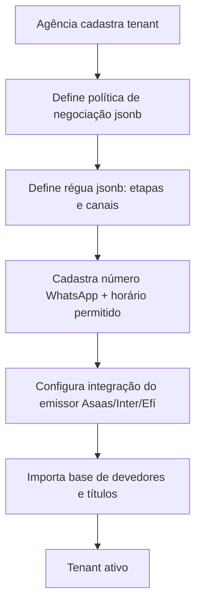

**O que é configurado:**

- **Política de negociação** (`tenants.política jsonb`): entrada mínima, nº máximo de
  parcelas, desconto máximo, regra de juros/multa, regra para pagamento parcial.
- **Régua** (`tenants.régua jsonb`): etapas (D-3, D0, D+1...), canal de cada etapa,
  templates.
- **Horário permitido**: janela de envio por tenant (compliance CDC).
- **Número WhatsApp** e credenciais da Evolution.
- **Integração do emissor** para webhooks de PIX/boleto.

**Regra:** nenhum tenant entra em produção sem política, régua, horário e base
legal (LGPD) registrados.

---

## 4. Fluxo 1 — Ingestão de títulos

Módulo `ingest/` no serviço **cadastro** — `POST /invoices/import` e `POST /webhooks/emissor`, task `import_invoices` na fila `cadastro`.

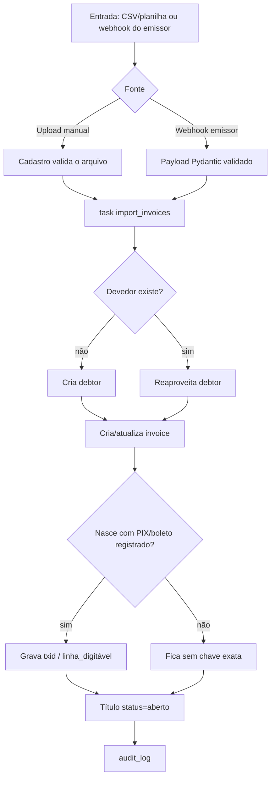

**Regras:**

- Deduplica título por chave natural do emissor (idempotência: reenvio do mesmo
  webhook não cria duplicata).
- `invoice.status` inicial = `aberto`; `vencimento` define a entrada na régua.
- `parent_id` fica nulo (só é preenchido quando um acordo gera parcelas).
- Devedor em `opt_out` continua sendo ingerido, mas **não entra na régua ativa**.

---

## 5. Fluxo 2 — Régua de cobrança (dunning)

Módulo `dunning/` — o Beat publica `run_dunning`; o **worker-cobranca** executa, na fila `cobranca`. **100%
determinística.** Rate limit por número.

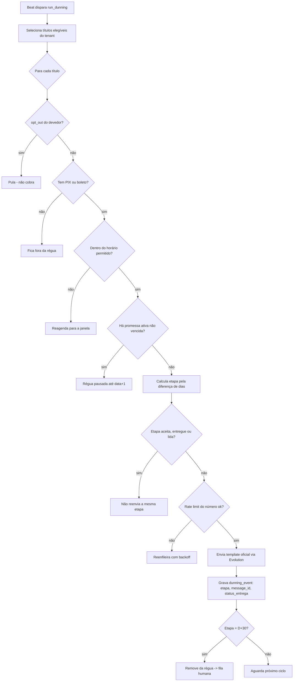

**Régua padrão (configurável):**

| Momento | Ação | Canal |
| --- | --- | --- |
| D-3 | Lembrete amigável + PIX copia-e-cola | WhatsApp template |
| D0 | Aviso de vencimento hoje | WhatsApp template |
| D+1 | "Não identificamos o pagamento" + 2ª via | WhatsApp template |
| D+3 | Convite a quitar, sem anunciar desconto | WhatsApp template |
| D+5 | Oferta de negociação dentro da política | WhatsApp template |
| D+7 | Novo convite a conversar, com o PIX | WhatsApp template |
| D+10 | Lembrete do título em aberto | WhatsApp template |
| D+15 | Última tentativa automática + aviso de encaminhamento | WhatsApp + e-mail |
| D+21 | Aviso de que a equipe assume, sem ameaça | WhatsApp template |
| D+30 | Sai da régua → fila humana | Painel |

**Regras duras:**

- Nunca envia fora do horário permitido do tenant.
- Não reenvia etapa aceita, entregue ou lida. Falha de entrega libera a mesma etapa no mesmo canal, ainda dentro do horário e do opt-out.
- Respeita `opt_out` imediatamente.
- Usa **template oficial aprovado na Meta** para disparo proativo. Sem ele, a etapa de WhatsApp não sai e o texto livre não entra no lugar.
- A ativação da conta exige número pareado (`open` na Evolution) e template aprovado em cada etapa de WhatsApp. Faltando um dos dois, a régua continua desligada. Em produção também exige o parecer do SETL-15 em `LEGAL_OPINION_REF`.
- Promessa ativa **pausa** a régua até `data_prometida + 1`.
- Disparo proativo é sempre determinístico — o LLM **não** inicia conversas. O texto livre do modelo só responde quem já falou.
- Título sem PIX copia-e-cola e sem linha digitável não recebe etapa, nem o handoff de D+30. Quando o código chega, sai só a etapa vigente.

---

## 6. Fluxo 3 — Inbound do WhatsApp e classificação de intenção

Módulo `channels/whatsapp.py` no serviço **cobranca**. O webhook chega no gateway e é encaminhado. Debounce no Redis; a classificação vai para a fila `cobranca-llm`. Comprovante é enfileirado em `conciliacao-llm`.

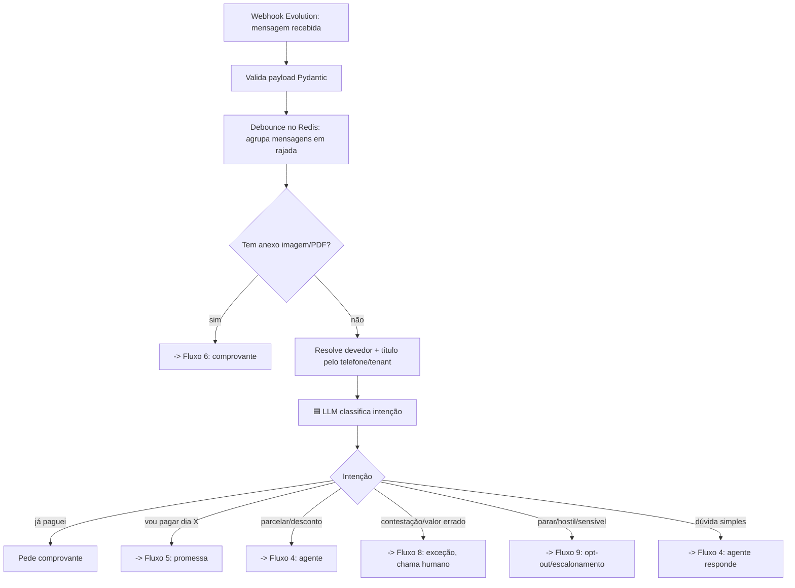

**Intenções e ações:**

| Intenção | Ação determinística | Envolve agente? |
| --- | --- | --- |
| *Já paguei* | Pede comprovante, encaminha ao motor de conciliação | não |
| *Vou pagar dia X* | Registra promessa, pausa régua até X+1 | não |
| *Quero parcelar/desconto* | Consulta política e oferta só o que cabe | 🟦 sim |
| *Contestação / valor errado* | **Não negocia** — abre exceção, avisa humano | não |
| *Parar / hostil / sensível* | Opt-out ou escalonamento imediato | não |

**Regras:**

- Debounce evita responder a cada mensagem de uma rajada; agrupa e responde uma vez.
- Antes de mostrar qualquer valor: **confirmar identidade** (ex.: 3 dígitos do CPF).
- Nunca responde valores em grupo — só em conversa 1:1.
- Toda mensagem (entrada e saída) é registrada e vinculada ao título.

---

## 7. Fluxo 4 — Agente de negociação (LangGraph)

Módulo `agent/` no **worker-cobranca** (fila `cobranca-llm`) — grafo LangGraph com tools tipadas (Pydantic), checkpointer no
Postgres, `interrupt` para pausa humana.

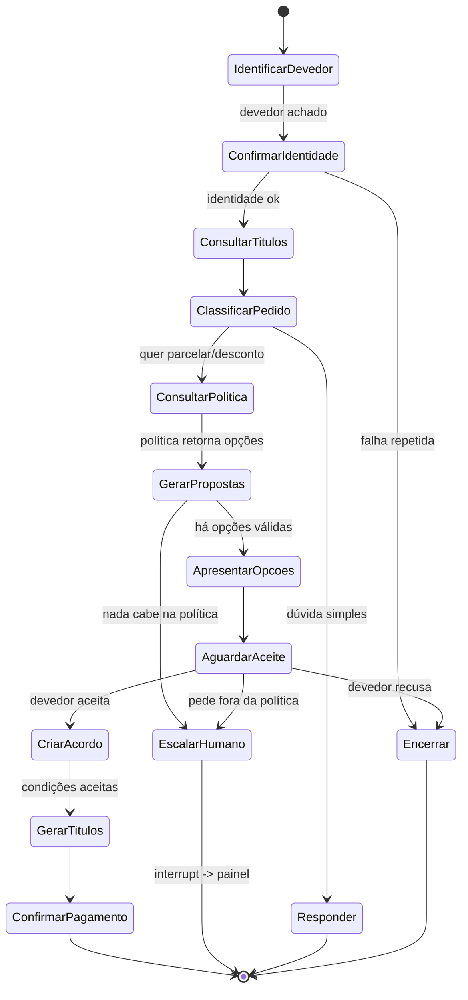

**Tools (todas tipadas, só retornam o permitido):**

- `get_debtor_invoices(debtor_id)` → títulos em aberto do devedor.
- `get_negotiation_policy(tenant_id)` → entrada mínima, nº máx. parcelas, desconto máx.
- `build_payment_options(invoices, policy)` → 🟩 **gera as opções válidas** (determinístico).
- `register_promise(invoice_id, data)` → cria promessa.
- `create_agreement(debtor_id, títulos_origem, condições)` → cria acordo + títulos.
- `request_human(reason)` → `interrupt` do grafo → fila de aprovações.

**Regras duras do agente:**

- Nunca inventa valores — escolhe **entre opções que `build_payment_options` devolveu**.
- Nunca oferece fora da política (entrada, parcelas, desconto).
- Nunca ameaça, nunca menciona terceiros.
- Qualquer pedido fora da política → `request_human` (não negocia por conta própria).
- Memória da conversa persistida no Postgres (checkpointer) por devedor.

**Geração de acordo:** ao aceitar, a tool emite cada parcela no emissor do tenant
(PIX ou boleto) e só então cria `agreements` e os novos `invoices`, com o código
de pagamento, ligados por `parent_id` ao primeiro título de origem e por
`agreement_id`. Os títulos originais mudam para `renegociado`. Sem emissor ou sem
código, nada é gravado e o pedido vai para aprovação. Pedido fora da política
continua em `request_human`, sem o agente inventar condição.

---

## 8. Fluxo 5 — Promessas de pagamento

A promessa nasce no **worker-cobranca**, no mesmo turno do inbound. A verificação no dia seguinte é a task `check_promises`, publicada pelo Beat às 07:00 na fila `cobranca`.

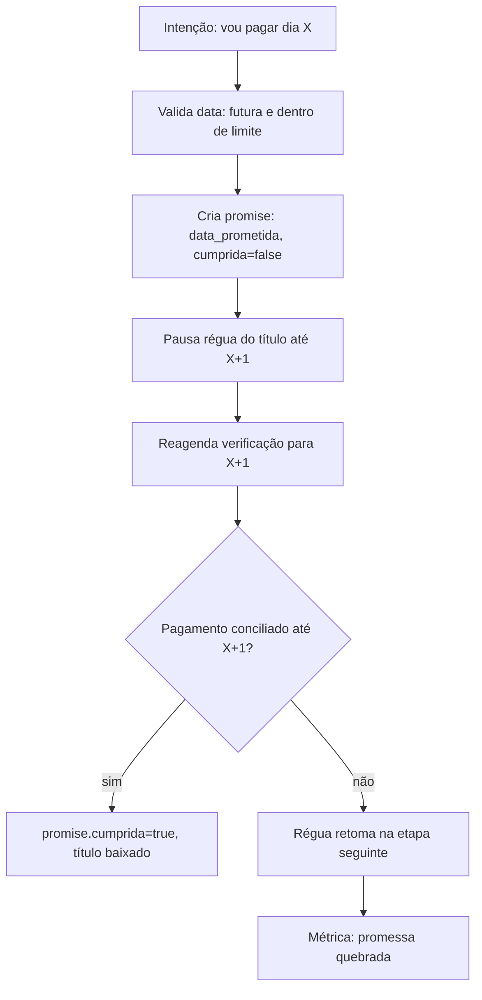

**Regras:**

- Data prometida precisa ser futura e dentro de um limite razoável (configurável).
- Enquanto a promessa está ativa e não vencida, a régua fica **pausada**.
- A verificação de cumprimento é feita pela **conciliação** (não por confiança no texto).
- Promessas cumpridas ÷ feitas é uma métrica do painel.

---

## 9. Fluxo 6 — Processamento de comprovante

Módulo `receipts/` no **worker-conciliacao** (fila `conciliacao-llm`) — extração com `with_structured_output` (Pydantic). 🟦 LLM lê;
🟩 validação é determinística.

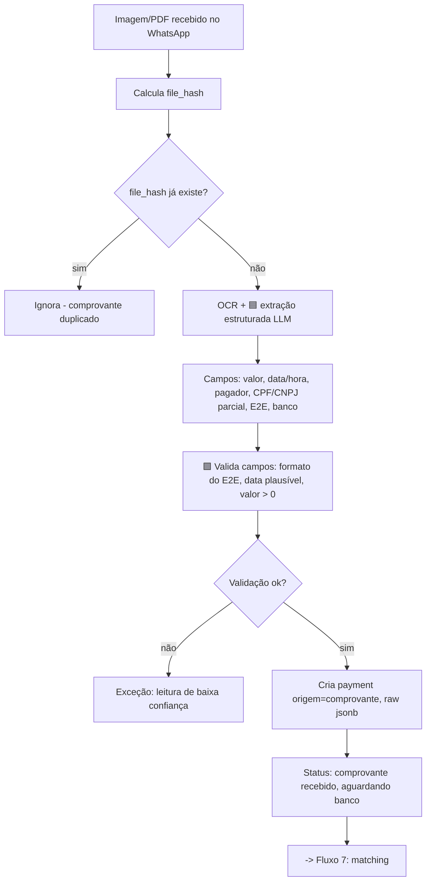

**Regras:**

- **Deduplicação por `file_hash`** (índice único em `payments.file_hash`): mesmo
  arquivo não vira dois pagamentos.
- Campos extraídos pelo LLM passam por **validação determinística** (E2E no formato
  certo, data plausível, valor positivo). Baixa confiança → exceção.
- O comprovante **nunca baixa definitivo sozinho** — fica `aguardando banco` até
  bater com extrato/webhook. Isso bloqueia comprovante falso.

---

## 10. Fluxo 7 — Conciliação / matching em camadas

Módulo `reconciliation/` no **worker-conciliacao** (fila `conciliacao`) — matcher em camadas, **Python puro, sem LLM**. Para no
primeiro que casa.

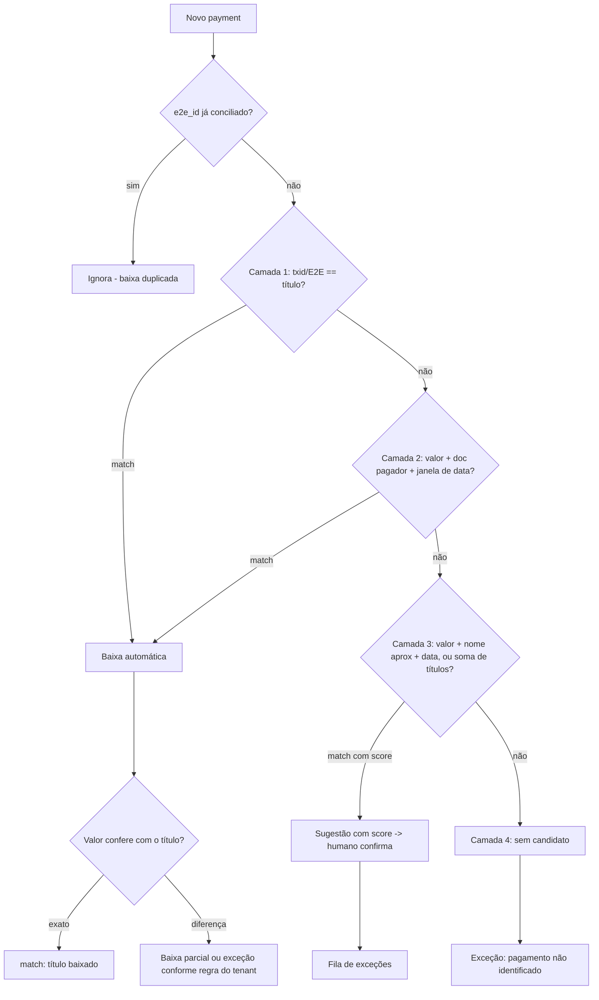

**Camadas de matching (ordem de confiança):**

| Camada | Critério | Resultado |
| --- | --- | --- |
| 1 | `txid` / ID E2E igual ao do título | Baixa automática |
| 2 | Valor + documento do pagador + janela de data | Baixa automática |
| 3 | Valor + nome aproximado + data, ou soma de vários títulos | Sugestão com score → humano |
| 4 | Sem candidato | Exceção "não identificado" |

**Confirmação banco (antifraude):** a baixa só vira **definitiva** quando o
pagamento tem origem (ou confirmação cruzada) de `extrato`/`webhook`. Comprovante
isolado fica `aguardando banco`.

**Diferença de valor:**

- Juros/multa ou desconto dentro da política → aplica regra do tenant.
- Pagamento parcial → `match.valor_aplicado` parcial, título fica `parcialmente pago`.
- Diferença fora da regra → exceção.

**Proteções:**

- Unicidade de `e2e_id` e `file_hash` no banco + **locks no Redis** evitam baixa
  duplicada em concorrência.
- `matches` é N:N (um pagamento pode quitar vários títulos; vários pagamentos podem
  quitar um título).

---

## 11. Fluxo 8 — Fila de exceções e revisão humana

Tela **Exceções** do painel (fase 1). O painel chama o gateway; quem confirma ou rejeita é o serviço **conciliacao** (`/exceptions`).

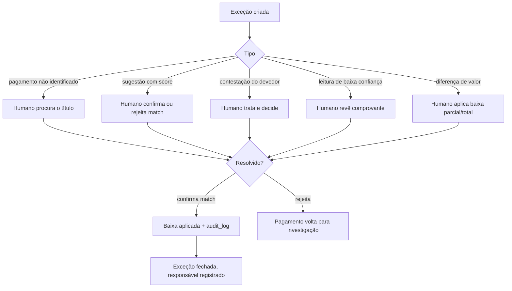

**Tipos de exceção:**

- `pagamento_nao_identificado` — camada 4 do matching.
- `sugestao_match` — camada 3, aguardando confirmação.
- `contestacao` — devedor contesta valor/cobrança.
- `leitura_baixa_confianca` — extração do comprovante falhou na validação.
- `diferenca_valor` — pagamento diverge do título fora da regra.

**Regras:**

- Toda confirmação/rejeição passa pela **API** (o Next.js nunca escreve direto no banco).
- Cada ação registra `responsável` e grava `audit_log`.
- Fila deve ser **curta** — é o indicador de qualidade do matching (% de baixa automática).

---

## 12. Fluxo 9 — Opt-out e escalonamento

Roda no **worker-cobranca**, no mesmo roteamento do inbound. O painel só entra quando a conversa já foi para humano.

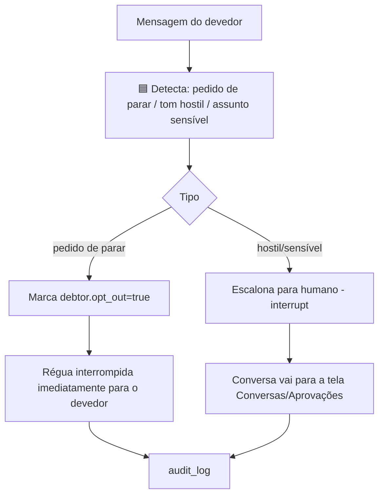

**Regras:**

- `opt_out` é respeitado **na hora** — nenhum disparo proativo seguinte.
- Tom hostil ou assunto sensível → o agente **para de conversar** e escalona; não
  tenta "contornar".
- Nunca ameaça, nunca insiste após pedido de parar (compliance CDC art. 42).

---

## 13. Máquina de estados do título (`invoice`)

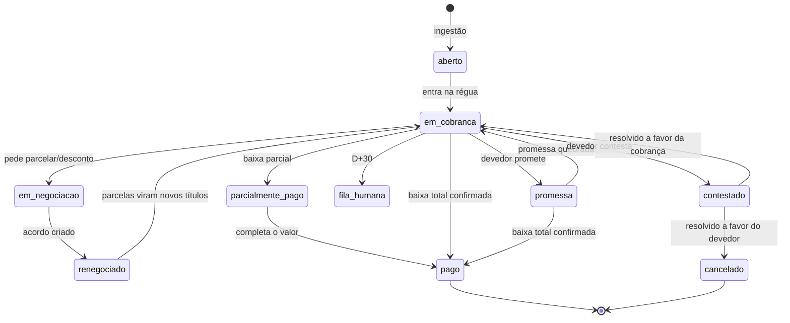

| Estado | Significado |
| --- | --- |
| `aberto` | Criado, ainda não entrou na régua |
| `em_cobranca` | Dentro da régua ativa |
| `promessa` | Régua pausada por promessa |
| `em_negociacao` | Agente negociando parcelamento/desconto |
| `renegociado` | Substituído por parcelas (acordo) |
| `parcialmente_pago` | Baixa parcial aplicada |
| `pago` | Quitado e confirmado pelo banco |
| `fila_humana` | Saiu da régua (D+30) |
| `contestado` | Devedor abriu contestação |
| `cancelado` | Encerrado sem pagamento |

---

## 14. Máquina de estados do pagamento (`payment`)

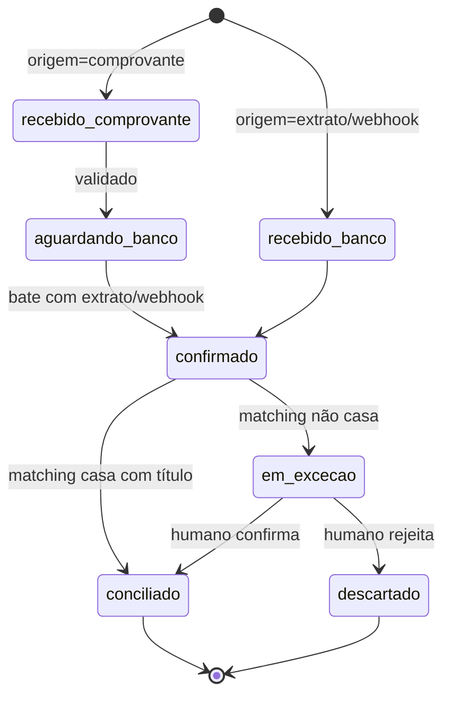

**Regra central (antifraude):** só sai de `aguardando_banco` para `confirmado`
quando há confirmação do banco. Comprovante sozinho **nunca** baixa definitivo.

---

## 15. Matriz de guardrails por fluxo

| Guardrail | Fluxos afetados | Como é garantido |
| --- | --- | --- |
| Horário permitido por tenant | 2, 3 | Checagem determinística antes de qualquer envio |
| Opt-out respeitado na hora | 2, 9 | `debtor.opt_out` bloqueia disparo no `run_dunning` |
| Nunca cobrar em grupo | 3, 4 | Só responde valores em conversa 1:1 |
| Confirmar identidade antes de valores | 3, 4 | Estado `ConfirmarIdentidade` no grafo |
| Agente não inventa condição | 4 | Tools só retornam opções válidas da política |
| Pedido fora da política escala | 4 | `request_human` / `interrupt` |
| Comprovante falso | 6, 7, 14 | Baixa definitiva só com confirmação do banco |
| Baixa duplicada | 6, 7 | Unicidade `e2e_id`/`file_hash` + locks Redis |
| Alucinação na leitura | 6 | Validação determinística dos campos → exceção |
| Templates oficiais / rate limit | 2 | Evita banimento do número |
| LGPD / rastreabilidade | todos | `audit_log` + RLS por `tenant_id` |
| Next.js não escreve no banco | 8, 11 | Toda ação passa pelo gateway e pelo serviço dono |

---

> **Resumo.** O produto encadeia nove fluxos onde a IA fica confinada a
> interpretar linguagem (intenção, comprovante, negociação) e **toda decisão sobre
> dinheiro é código determinístico guiado pela política do tenant**, com o banco
> como fonte de verdade para baixas e o humano como última instância nas exceções.
